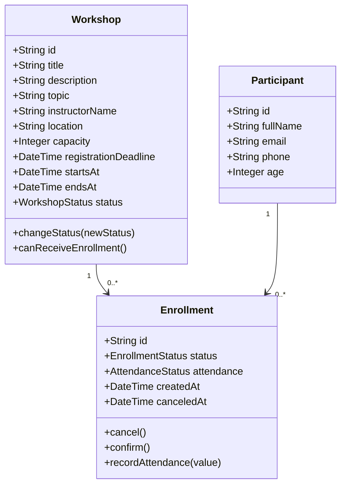
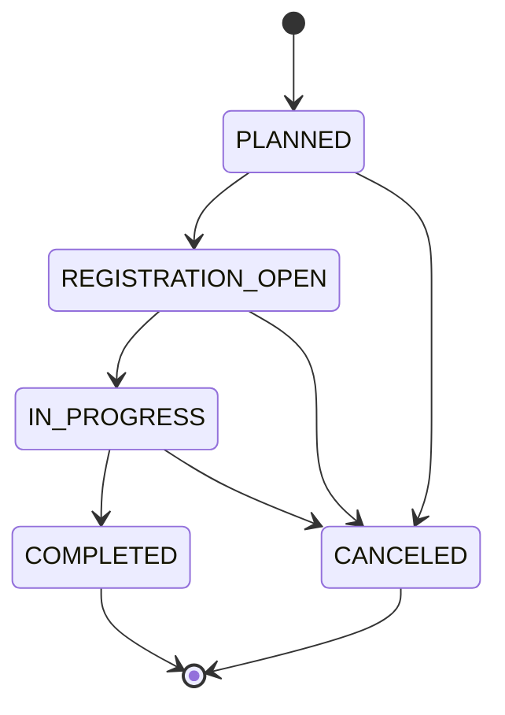
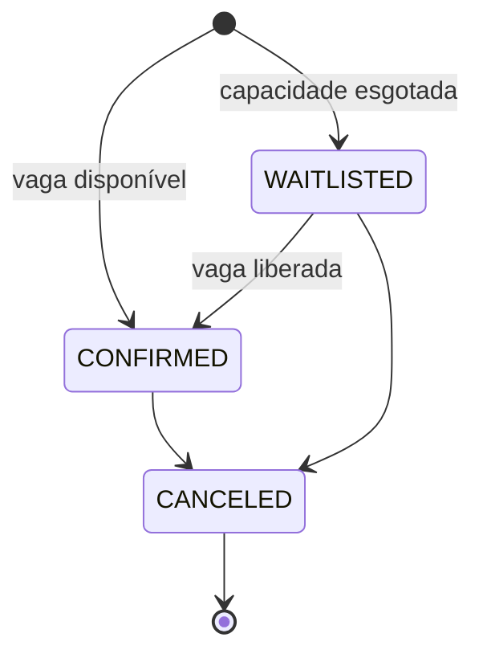
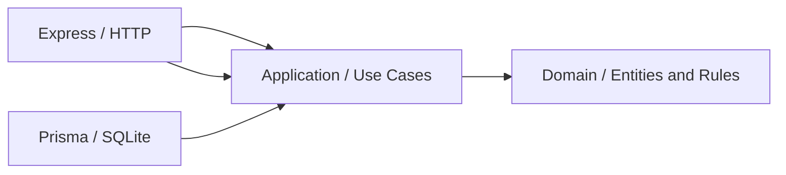
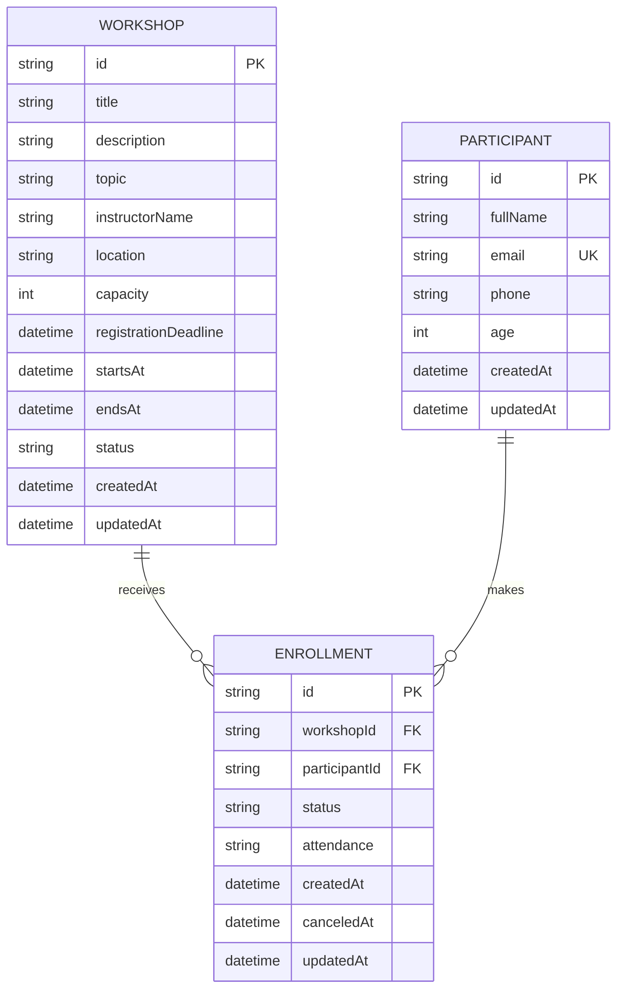
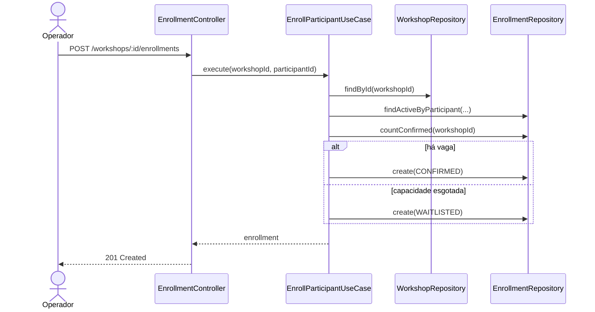
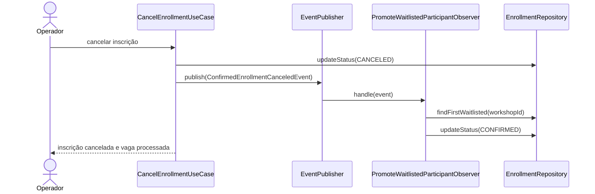

# Software Design Document — TechParaTodos API

| Campo | Valor |
|---|---|
| Projeto | TechParaTodos API |
| Versão do documento | 1.0 |
| Data | 15/11/2026 |
| Status | Proposta para aprovação |
| Tipo de produto | API RESTful / MVP acadêmico e de extensão |
| Stack | JavaScript, Node.js, Express, Prisma, SQLite, Jest e Swagger |

## 1. Visão geral

O **TechParaTodos** é uma API RESTful para organizar oficinas gratuitas de tecnologia destinadas à comunidade. O sistema permite cadastrar oficinas, participantes e inscrições, controlar vagas e lista de espera, registrar presença e acompanhar o ciclo de vida das atividades.

O projeto atende a dois objetivos:

1. Servir como trabalho final da disciplina de Análise e Projeto de Sistemas II, demonstrando Clean Architecture, DDD, SOLID, padrões GoF/GRASP, testes com TDD e documentação OpenAPI.
2. Apoiar uma Atividade Curricular de Extensão, na qual a equipe oferecerá gratuitamente uma oficina de tecnologia a um público externo e utilizará o sistema para organizar a atividade.

### 1.1 Problema

Pequenas oficinas comunitárias costumam controlar inscrições por mensagens, listas de papel ou planilhas. Isso dificulta saber quantas vagas ainda existem, identificar inscrições duplicadas, organizar a lista de espera e registrar a presença dos participantes.

### 1.2 Solução proposta

A API centraliza o gerenciamento das oficinas e aplica automaticamente regras de capacidade, conflitos de horário, lista de espera e presença. O Swagger UI será utilizado como interface operacional durante o MVP e a demonstração acadêmica.

## 2. Objetivos e limites

### 2.1 Objetivos do MVP

- Manter oficinas por meio de CRUD completo.
- Manter participantes.
- Inscrever participantes em oficinas.
- Confirmar a inscrição enquanto houver vaga.
- Colocar automaticamente inscrições excedentes na lista de espera.
- Promover a primeira pessoa da lista quando uma vaga for liberada.
- Controlar transições de status das oficinas.
- Registrar presença ou ausência.
- Expor documentação interativa em `/api-docs`.
- Possuir testes unitários e de integração com cobertura geral mínima de 40%.

### 2.2 Fora do escopo do MVP

- Front-end web ou aplicativo móvel.
- Login, recuperação de senha e controle de perfis.
- Pagamentos.
- Emissão de certificados.
- Envio real de e-mail, SMS ou WhatsApp.
- Transmissão de aulas ou armazenamento de vídeos.
- Integração com calendários externos.
- Gestão completa de conteúdo didático.

Esses itens podem ser registrados como evolução futura, mas não devem bloquear a entrega do trabalho.

## 3. Público e aplicação na ACE

### 3.1 Público-alvo

Pessoas da comunidade interessadas em conteúdos introdutórios de tecnologia, como programação, criação de páginas web, segurança digital ou uso responsável de inteligência artificial.

Para reduzir burocracia no primeiro piloto, recomenda-se trabalhar com participantes maiores de idade. Caso a ação inclua menores, a equipe deverá providenciar as autorizações exigidas para participação e uso de imagem.

### 3.2 Ação de extensão sugerida

Realizar uma oficina gratuita de 1 a 2 horas com um dos temas:

- Introdução à programação com JavaScript.
- Criação da primeira página com HTML e CSS.
- Segurança digital e prevenção de golpes.
- Uso responsável de inteligência artificial.

### 3.3 Uso do sistema durante a ação

1. A equipe cadastra a oficina.
2. Os interessados são cadastrados como participantes.
3. As inscrições são registradas pela API.
4. O sistema controla vagas e lista de espera.
5. No dia da ação, a equipe registra as presenças.
6. Os resultados são utilizados no relatório da ACE, sem divulgar dados pessoais.

## 4. Premissas

- A aplicação será operada pela equipe por meio do Swagger ou Postman.
- O MVP funcionará localmente com SQLite.
- A oficina piloto terá uma única turma, mas o domínio permitirá várias oficinas.
- A equipe definirá uma pessoa responsável pelo grupo comunitário para validar a ação e assinar a declaração, após confirmação do professor.
- O sistema armazenará apenas os dados pessoais estritamente necessários.
- O deploy público é opcional. Se ocorrer, as rotas administrativas deverão receber proteção adicional.

## 5. Requisitos funcionais

| ID | Requisito |
|---|---|
| RF-01 | Cadastrar, consultar, listar, atualizar e excluir oficinas. |
| RF-02 | Cadastrar, consultar, listar, atualizar e excluir participantes, respeitando as restrições do domínio. |
| RF-03 | Alterar o status de uma oficina por uma operação específica. |
| RF-04 | Inscrever um participante em uma oficina. |
| RF-05 | Confirmar a inscrição automaticamente quando houver vaga. |
| RF-06 | Colocar a inscrição na lista de espera quando a capacidade estiver esgotada. |
| RF-07 | Cancelar uma inscrição. |
| RF-08 | Promover automaticamente a inscrição mais antiga da lista de espera após uma vaga ser liberada. |
| RF-09 | Listar inscrições de uma oficina, com filtro opcional por status. |
| RF-10 | Registrar presença ou ausência de participantes confirmados. |
| RF-11 | Exibir todos os endpoints e schemas no Swagger UI. |
| RF-12 | Retornar erros padronizados e códigos HTTP adequados. |

## 6. Regras de negócio

| ID | Regra |
|---|---|
| RN-01 | Apenas oficinas com status `REGISTRATION_OPEN` aceitam inscrições. |
| RN-02 | A data final deve ser posterior à data inicial. |
| RN-03 | A capacidade deve ser um número inteiro maior que zero. |
| RN-04 | O prazo de inscrição não pode ser posterior ao início da oficina. |
| RN-05 | Um participante não pode possuir duas inscrições ativas na mesma oficina. |
| RN-06 | Um participante não pode ter inscrição confirmada em oficinas com horários sobrepostos. |
| RN-07 | Apenas inscrições com status `CONFIRMED` ocupam vagas. |
| RN-08 | Quando não houver vagas, a nova inscrição recebe o status `WAITLISTED`. |
| RN-09 | Ao cancelar uma inscrição confirmada, a inscrição elegível mais antiga da lista de espera deve ser promovida. |
| RN-10 | Uma inscrição cancelada não pode ser reativada. Uma nova inscrição deverá ser criada. |
| RN-11 | Presença ou ausência só pode ser registrada em inscrição confirmada. |
| RN-12 | O registro de presença só é permitido quando a oficina estiver `IN_PROGRESS` ou `COMPLETED`. |
| RN-13 | Uma oficina só pode ser excluída quando estiver `PLANNED` e não possuir inscrições. Nos demais casos, deverá ser cancelada. |
| RN-14 | Um participante com inscrições ativas não pode ser excluído. |
| RN-15 | A transição de status deve obedecer ao fluxo definido na seção 8. |

## 7. Modelo de domínio

### 7.1 Entidades

#### Workshop — Oficina

| Campo | Tipo | Restrições |
|---|---|---|
| id | UUID/String | Identificador único |
| title | String | Obrigatório, 3 a 100 caracteres |
| description | String | Obrigatório, até 1000 caracteres |
| topic | String | Obrigatório, até 100 caracteres |
| instructorName | String | Obrigatório, até 100 caracteres |
| location | String | Obrigatório, até 150 caracteres |
| capacity | Integer | Maior que zero |
| registrationDeadline | DateTime | Igual ou anterior ao início |
| startsAt | DateTime | Obrigatório |
| endsAt | DateTime | Posterior ao início |
| status | WorkshopStatus | Inicia como `PLANNED` |
| createdAt | DateTime | Gerado pelo sistema |
| updatedAt | DateTime | Atualizado pelo sistema |

#### Participant — Participante

| Campo | Tipo | Restrições |
|---|---|---|
| id | UUID/String | Identificador único |
| fullName | String | Obrigatório, 3 a 120 caracteres |
| email | String | Obrigatório, válido e único |
| phone | String | Opcional, até 20 caracteres |
| age | Integer | Opcional; não armazenar data de nascimento |
| createdAt | DateTime | Gerado pelo sistema |
| updatedAt | DateTime | Atualizado pelo sistema |

#### Enrollment — Inscrição

| Campo | Tipo | Restrições |
|---|---|---|
| id | UUID/String | Identificador único |
| workshopId | String | Referência à oficina |
| participantId | String | Referência ao participante |
| status | EnrollmentStatus | `CONFIRMED`, `WAITLISTED` ou `CANCELED` |
| attendance | AttendanceStatus | `PENDING`, `PRESENT` ou `ABSENT` |
| createdAt | DateTime | Define a ordem da lista de espera |
| canceledAt | DateTime | Preenchido no cancelamento |
| updatedAt | DateTime | Atualizado pelo sistema |

### 7.2 Diagrama de classes



### 7.3 Agregados e invariantes

- **Workshop** é a raiz do agregado responsável por status, capacidade e aceitação de inscrições.
- **Participant** mantém a identidade e os dados mínimos de contato.
- **Enrollment** representa a relação entre oficina e participante e protege seu próprio fluxo de status.
- A capacidade deve ser conferida dentro de transação para evitar duas confirmações simultâneas ocupando a última vaga.

## 8. Fluxos de estado

### 8.1 Estado da oficina



### 8.2 Estado da inscrição



`PRESENT` e `ABSENT` são valores de presença e não substituem o status da inscrição.

## 9. Arquitetura

### 9.1 Estilo arquitetural

O projeto utilizará Clean Architecture com quatro áreas:



As dependências apontam para o domínio. Entidades e regras não importam Express, Prisma ou Swagger.

### 9.2 Responsabilidades das camadas

| Camada | Responsabilidade |
|---|---|
| Domain | Entidades, estados, eventos, erros e regras independentes de framework. |
| Application | Casos de uso, portas de repositório, DTOs e orquestração. |
| Infrastructure | Prisma, SQLite, implementações de repositórios e publicador de eventos. |
| Interfaces | Controllers, rotas, validação Zod e middleware de erros. |

### 9.3 Estrutura de pastas

```text
tech-para-todos-api/
├── prisma/
│   ├── migrations/
│   └── schema.prisma
├── src/
│   ├── domain/
│   │   ├── entities/
│   │   │   ├── Workshop.js
│   │   │   ├── Participant.js
│   │   │   └── Enrollment.js
│   │   ├── states/
│   │   │   ├── WorkshopState.js
│   │   │   ├── PlannedWorkshopState.js
│   │   │   ├── RegistrationOpenWorkshopState.js
│   │   │   ├── InProgressWorkshopState.js
│   │   │   ├── CompletedWorkshopState.js
│   │   │   └── CanceledWorkshopState.js
│   │   ├── events/
│   │   │   └── ConfirmedEnrollmentCanceledEvent.js
│   │   └── errors/
│   ├── application/
│   │   ├── ports/
│   │   │   ├── WorkshopRepository.js
│   │   │   ├── ParticipantRepository.js
│   │   │   ├── EnrollmentRepository.js
│   │   │   └── EventPublisher.js
│   │   ├── useCases/
│   │   │   ├── workshops/
│   │   │   ├── participants/
│   │   │   └── enrollments/
│   │   └── observers/
│   │       └── PromoteWaitlistedParticipantObserver.js
│   ├── infrastructure/
│   │   ├── database/
│   │   │   └── prismaClient.js
│   │   ├── repositories/
│   │   │   ├── PrismaWorkshopRepository.js
│   │   │   ├── PrismaParticipantRepository.js
│   │   │   └── PrismaEnrollmentRepository.js
│   │   └── events/
│   │       └── InMemoryEventPublisher.js
│   ├── interfaces/
│   │   ├── http/
│   │   │   ├── controllers/
│   │   │   ├── routes/
│   │   │   ├── schemas/
│   │   │   └── middlewares/
│   │   └── swagger/
│   ├── config/
│   │   └── container.js
│   ├── app.js
│   └── server.js
├── tests/
│   ├── unit/
│   ├── integration/
│   └── helpers/
├── .env.example
├── jest.config.js
├── package.json
├── swagger.json
└── README.md
```

## 10. Componentes e casos de uso

### 10.1 Oficinas

- `CreateWorkshopUseCase`
- `GetWorkshopUseCase`
- `ListWorkshopsUseCase`
- `UpdateWorkshopUseCase`
- `DeleteWorkshopUseCase`
- `ChangeWorkshopStatusUseCase`

### 10.2 Participantes

- `CreateParticipantUseCase`
- `GetParticipantUseCase`
- `ListParticipantsUseCase`
- `UpdateParticipantUseCase`
- `DeleteParticipantUseCase`

### 10.3 Inscrições

- `EnrollParticipantUseCase`
- `CancelEnrollmentUseCase`
- `ListWorkshopEnrollmentsUseCase`
- `RecordAttendanceUseCase`
- `PromoteWaitlistedParticipantUseCase`

### 10.4 Injeção de dependências

O arquivo `src/config/container.js` será o único ponto de composição. Ele criará os repositórios e os injetará nos casos de uso; os controllers receberão casos de uso prontos. Nenhum caso de uso deverá instanciar diretamente Prisma, repositórios concretos ou controllers.

## 11. Padrões de projeto

### 11.1 State — GoF

**Problema:** as operações permitidas mudam conforme o estado da oficina. Condicionais espalhadas aumentariam o acoplamento e dificultariam novas regras.

**Solução:** cada estado implementará o contrato `WorkshopState`, com operações como:

```text
canTransitionTo(nextStatus)
canReceiveEnrollment(currentDate)
canRecordAttendance()
```

A entidade `Workshop` delegará essas decisões ao objeto de estado correspondente.

### 11.2 Observer — GoF

**Problema:** o cancelamento de uma inscrição confirmada deve provocar outra ação: promover alguém da lista de espera. O caso de uso de cancelamento não deve conhecer os detalhes da promoção.

**Solução:** `CancelEnrollmentUseCase` publicará `ConfirmedEnrollmentCanceledEvent`. O `PromoteWaitlistedParticipantObserver` reagirá ao evento e executará a promoção da inscrição elegível mais antiga.

O publicador será síncrono no MVP para manter comportamento previsível e facilitar os testes. A operação de cancelamento e promoção deverá ser executada na mesma transação de aplicação sempre que possível.

### 11.3 Repository — GRASP

Os contratos de repositório abstraem a persistência. Casos de uso dependem de interfaces da aplicação e não do Prisma.

### 11.4 Controller — GRASP

Controllers recebem as requisições HTTP, convertem dados para DTOs, executam casos de uso e produzem respostas. Eles não contêm regras de negócio.

## 12. Aplicação dos princípios SOLID

| Princípio | Aplicação |
|---|---|
| SRP | Entidades protegem regras; casos de uso executam uma operação; controllers tratam HTTP; repositórios persistem dados. |
| OCP | Novos estados e observadores podem ser adicionados sem alterar controllers ou repositórios existentes. |
| LSP | Implementações Prisma e mocks obedecem aos mesmos contratos de repositório. |
| ISP | Cada repositório expõe apenas operações necessárias ao seu domínio. |
| DIP | Casos de uso dependem de contratos injetados e não de implementações concretas. |

## 13. Persistência

### 13.1 Banco de dados

SQLite será usado no desenvolvimento e na demonstração. O Prisma permitirá futura troca para PostgreSQL sem alterar o domínio ou os casos de uso.

### 13.2 Modelo relacional



### 13.3 Restrições e índices

- E-mail de participante único.
- Índice composto em `Enrollment(workshopId, status, createdAt)` para a fila.
- Índice em `Workshop(status, startsAt)` para listagens.
- Restrição única composta em `Enrollment(workshopId, participantId, status)` não deve impedir histórico cancelado. A duplicidade ativa será garantida pelo caso de uso e por transação.
- Exclusões de entidades relacionadas serão restritas. O sistema não usará `CASCADE` para apagar histórico automaticamente.

## 14. API RESTful

Prefixo: `/api/v1`

### 14.1 Oficinas

| Método | Rota | Resultado |
|---|---|---|
| POST | `/workshops` | Cria uma oficina. |
| GET | `/workshops` | Lista oficinas; aceita filtros `status`, `topic`, `from` e `to`. |
| GET | `/workshops/:id` | Consulta uma oficina. |
| PUT | `/workshops/:id` | Atualiza dados permitidos. |
| DELETE | `/workshops/:id` | Exclui oficina planejada sem inscrições. |
| PATCH | `/workshops/:id/status` | Executa uma transição de status. |

### 14.2 Participantes

| Método | Rota | Resultado |
|---|---|---|
| POST | `/participants` | Cadastra um participante. |
| GET | `/participants` | Lista participantes. |
| GET | `/participants/:id` | Consulta um participante. |
| PUT | `/participants/:id` | Atualiza um participante. |
| DELETE | `/participants/:id` | Exclui participante sem inscrições ativas. |

### 14.3 Inscrições e presença

| Método | Rota | Resultado |
|---|---|---|
| POST | `/workshops/:workshopId/enrollments` | Inscreve um participante. |
| GET | `/workshops/:workshopId/enrollments` | Lista inscrições da oficina. |
| GET | `/enrollments/:id` | Consulta uma inscrição. |
| PATCH | `/enrollments/:id/cancel` | Cancela uma inscrição. |
| PATCH | `/enrollments/:id/attendance` | Registra presença ou ausência. |

### 14.4 Exemplos de payload

Criação de oficina:

```json
{
  "title": "Introdução à programação com JavaScript",
  "description": "Oficina gratuita para pessoas sem experiência prévia.",
  "topic": "Programação",
  "instructorName": "Equipe TechParaTodos",
  "location": "Sala comunitária",
  "capacity": 20,
  "registrationDeadline": "2026-11-27T23:59:59-03:00",
  "startsAt": "2026-11-28T14:00:00-03:00",
  "endsAt": "2026-11-28T16:00:00-03:00"
}
```

Inscrição:

```json
{
  "participantId": "participant-id"
}
```

Registro de presença:

```json
{
  "attendance": "PRESENT"
}
```

### 14.5 Respostas e códigos HTTP

| Código | Uso |
|---|---|
| 200 | Consulta ou atualização bem-sucedida. |
| 201 | Recurso criado. |
| 204 | Exclusão bem-sucedida sem corpo. |
| 400 | Payload, parâmetro ou formato inválido. |
| 404 | Recurso inexistente. |
| 409 | Duplicidade ou conflito de horário. |
| 422 | Regra de negócio impede a operação. |
| 500 | Erro interno não previsto. |

Formato de erro:

```json
{
  "error": {
    "code": "WORKSHOP_NOT_OPEN",
    "message": "A oficina não está aberta para inscrições.",
    "details": []
  }
}
```

## 15. Fluxos principais

### 15.1 Realização de inscrição



### 15.2 Cancelamento e promoção da fila



## 16. Validação e tratamento de erros

- Zod validará body, params e query antes do controller.
- Validações sintáticas permanecem na interface HTTP.
- Regras de negócio permanecem no domínio e nos casos de uso.
- O middleware `errorHandler` converterá erros conhecidos em respostas HTTP.
- Mensagens internas do Prisma não serão expostas ao cliente.
- Erros inesperados serão registrados no console durante o MVP e retornarão uma mensagem genérica.

## 17. Testes e TDD

### 17.1 Ferramentas

- Jest para testes unitários.
- Supertest para testes dos endpoints.
- Mocks ou repositórios em memória para isolar casos de uso.
- `jest --coverage` para aferir cobertura.

### 17.2 Distribuição

| Tipo | Alvo |
|---|---|
| Unitário | Entidades, estados, use cases e observador. |
| Integração | Rotas principais, validação, middleware e repositórios Prisma. |
| Contrato | Status HTTP e formato dos payloads documentados. |

### 17.3 Funcionalidade escolhida para TDD

O cancelamento com promoção da lista de espera será desenvolvido em vermelho-verde-refatoração:

1. **Vermelho:** escrever teste no qual uma oficina cheia possui uma inscrição em espera; após o cancelamento de uma inscrição confirmada, o teste espera que a primeira da fila seja promovida.
2. **Verde:** implementar o evento e o observador com o mínimo necessário para o teste passar.
3. **Refatoração:** separar contratos, melhorar nomes e remover duplicações sem alterar o comportamento.

Esse processo deverá ser registrado no README e, preferencialmente, em commits separados.

### 17.4 Casos mínimos de teste

- Criar oficina válida.
- Rejeitar oficina com fim anterior ao início.
- Rejeitar transição inválida de status.
- Confirmar inscrição quando houver vaga.
- Colocar inscrição na espera quando a oficina estiver cheia.
- Rejeitar inscrição duplicada.
- Rejeitar conflito de horário.
- Rejeitar inscrição em oficina fechada.
- Promover primeira inscrição da fila após cancelamento.
- Rejeitar presença para inscrição não confirmada.
- Retornar 404 para recurso inexistente.
- Retornar 400 para payload inválido.

Meta interna recomendada: pelo menos 70% nas camadas de domínio e aplicação, mantendo cobertura geral igual ou superior aos 40% exigidos.

## 18. Documentação OpenAPI

- Swagger UI disponível em `/api-docs`.
- Documento gerado com `swagger-autogen` e servido por `swagger-ui-express`.
- Cada endpoint deve apresentar descrição, parâmetros, body, exemplos e respostas possíveis.
- Schemas reutilizáveis: `Workshop`, `Participant`, `Enrollment`, `ErrorResponse`.
- A geração do Swagger fará parte do comando de desenvolvimento ou de um script dedicado.

Scripts sugeridos:

```json
{
  "start": "node src/server.js",
  "dev": "node --watch src/server.js",
  "test": "jest",
  "test:coverage": "jest --coverage",
  "swagger": "node src/interfaces/swagger/generateSwagger.js",
  "lint": "eslint .",
  "format": "prettier --write ."
}
```

## 19. Segurança e privacidade

- Coletar apenas nome, contato e idade opcional.
- Não armazenar documentos, endereço residencial, senha ou data de nascimento.
- Não expor a lista de participantes no relatório público.
- Usar dados fictícios em capturas técnicas quando possível.
- Obter autorização antes de utilizar fotos ou depoimentos na ACE.
- Manter `.env` e arquivos locais do SQLite fora do Git.
- Limitar tamanho de payload e habilitar `helmet`.
- Configurar CORS de forma restritiva caso a API seja publicada.
- Como não haverá autenticação no MVP, a API deverá permanecer local durante o piloto. Um deploy público exige autenticação das rotas administrativas.

## 20. Requisitos não funcionais

| ID | Requisito |
|---|---|
| RNF-01 | A API deverá utilizar JSON e seguir convenções HTTP. |
| RNF-02 | O código deverá executar em Node.js 18 ou superior. |
| RNF-03 | O domínio não poderá depender de Express ou Prisma. |
| RNF-04 | O projeto deverá iniciar localmente com instruções do README. |
| RNF-05 | O tempo de resposta esperado no ambiente local é inferior a 1 segundo para operações comuns. |
| RNF-06 | A cobertura geral de testes deverá ser de pelo menos 40%. |
| RNF-07 | O código deverá passar por ESLint e Prettier. |
| RNF-08 | A documentação Swagger deverá refletir os endpoints entregues. |

## 21. Observabilidade

O MVP utilizará logs estruturados no console contendo:

- método e rota;
- status HTTP;
- duração da requisição;
- código do erro, quando existir.

Dados pessoais e corpos completos de requisição não deverão aparecer nos logs.

## 22. Plano de implementação

### Etapa 1 — Modelagem e preparação

- Aprovar tema e escopo.
- Criar repositório e GitHub Project.
- Criar diagramas iniciais.
- Configurar Node, Express, Prisma, Jest, ESLint e Prettier.
- Criar estrutura da Clean Architecture.

### Etapa 2 — CRUD e persistência

- Implementar entidades.
- Criar schema Prisma e migrations.
- Implementar repositórios.
- Implementar CRUD de oficinas e participantes.
- Criar validações e middleware de erros.

### Etapa 3 — Regras principais

- Implementar State para oficinas.
- Implementar inscrições, capacidade e conflitos.
- Desenvolver cancelamento e Observer com TDD.
- Implementar presença.

### Etapa 4 — Entrega e ACE

- Completar testes e cobertura.
- Gerar Swagger.
- Revisar diagramas e README.
- Realizar a oficina comunitária.
- Coletar evidências e feedback.
- Finalizar relatório da ACE.

### Cronograma sugerido

| Período | Resultado |
|---|---|
| 15 a 19/11 | Tema aprovado, modelagem e repositório preparados. |
| 20 a 25/11 | CRUD, banco e arquitetura funcionando. |
| 26 a 30/11 | Inscrições, lista de espera, testes e ação comunitária. |
| 01 a 03/12 | Evidências, relatório da ACE e documentação. |
| 04/12 | Entrega do relatório da ACE. |
| 05 a 09/12 | Revisão técnica, cobertura, Swagger e apresentação. |
| 10/12 | Entrega final do projeto. |

## 23. Estratégia de Git e colaboração

- Branch principal protegida de alterações diretas quando possível.
- Uma branch por funcionalidade, como `feature/workshop-crud`.
- Pull requests revisados pelo outro integrante.
- Commits pequenos e distribuídos entre a dupla.
- Issues vinculadas aos requisitos e regras deste documento.
- O commit do teste vermelho deve anteceder o commit da implementação da funcionalidade TDD.

Divisão inicial sugerida:

| Integrante A | Integrante B |
|---|---|
| Domínio de oficinas e padrão State | Inscrições, Observer e lista de espera |
| Controllers e Swagger de oficinas | Repositórios e testes de inscrição |
| Diagrama de classes | Diagrama de arquitetura |

Ambos devem revisar e compreender todo o código.

## 24. Critérios de aceitação do MVP

- [ ] CRUD de oficinas funciona com validação e códigos HTTP adequados.
- [ ] Participantes podem ser cadastrados e consultados.
- [ ] Inscrição ocupa vaga ou entra na lista de espera corretamente.
- [ ] Inscrições duplicadas e conflitos de horário são rejeitados.
- [ ] Cancelamento de uma vaga confirmada promove a primeira pessoa da fila.
- [ ] Transições inválidas de oficina são rejeitadas pelo padrão State.
- [ ] Presença só é registrada nas condições permitidas.
- [ ] Controllers não contêm regras de negócio.
- [ ] Casos de uso não dependem diretamente de Prisma.
- [ ] State e Observer estão identificados e justificados no README.
- [ ] Testes executam sem erro e cobertura geral é igual ou superior a 40%.
- [ ] Swagger está acessível em `/api-docs` e documenta todos os endpoints entregues.
- [ ] README explica instalação, execução, testes, padrões e estrutura de pastas.
- [ ] Diagramas refletem o código final.
- [ ] A ação comunitária foi realizada e possui evidências e validação do público.

## 25. Riscos e respostas

| Risco | Probabilidade | Impacto | Resposta |
|---|---|---|---|
| Aumentar demais o escopo | Média | Alto | Manter front-end, autenticação e certificados fora do MVP. |
| Não conseguir público para a oficina | Média | Alto | Divulgar cedo e trabalhar com um grupo pequeno de adultos da comunidade. |
| Falta de responsável para assinar a declaração | Média | Alto | Confirmar previamente com o professor quem pode representar o grupo. |
| Dificuldade para demonstrar Observer | Baixa | Médio | Usar cancelamento e promoção da fila como cenário central de TDD. |
| Corrida pela última vaga | Baixa no piloto | Médio | Executar contagem e criação dentro de transação. |
| Exposição de dados pessoais | Baixa | Alto | Minimizar coleta, manter banco local e anonimizar evidências. |
| Cobertura insuficiente perto da entrega | Média | Médio | Testar cada caso de uso durante a implementação. |

## 26. Decisões arquiteturais

| ID | Decisão | Justificativa |
|---|---|---|
| ADR-01 | Usar JavaScript com Node.js e Express. | Stack obrigatória da disciplina. |
| ADR-02 | Usar SQLite com Prisma. | Configuração simples e suficiente para o piloto local. |
| ADR-03 | Usar Swagger como interface do MVP. | Evita o custo de um front-end sem prejudicar a demonstração da API. |
| ADR-04 | Usar State para o ciclo da oficina. | Centraliza permissões e transições de cada estado. |
| ADR-05 | Usar Observer para promoção da lista de espera. | Desacopla o cancelamento de seus efeitos posteriores. |
| ADR-06 | Não implementar autenticação no MVP local. | Mantém o escopo controlado; deploy público exigirá revisão da decisão. |
| ADR-07 | Armazenar presença na inscrição. | Evita uma tabela adicional sem perder a regra necessária ao MVP. |

## 27. Evoluções futuras

- Formulário web de inscrição.
- Autenticação de organizadores.
- Notificações por e-mail ou WhatsApp.
- Certificados digitais.
- Avaliação da oficina pelos participantes.
- Relatórios de impacto social.
- Integração com calendário.
- Migração para PostgreSQL e deploy em nuvem.

## 28. Definição de pronto

Uma funcionalidade será considerada pronta quando:

1. Possuir regra e critério de aceitação definidos.
2. Respeitar as dependências entre as camadas.
3. Possuir testes unitários relevantes.
4. Possuir validação de entrada e tratamento de erro.
5. Estar documentada no Swagger quando exposta por HTTP.
6. Passar por revisão do outro integrante.
7. Não reduzir a cobertura abaixo da meta exigida.

